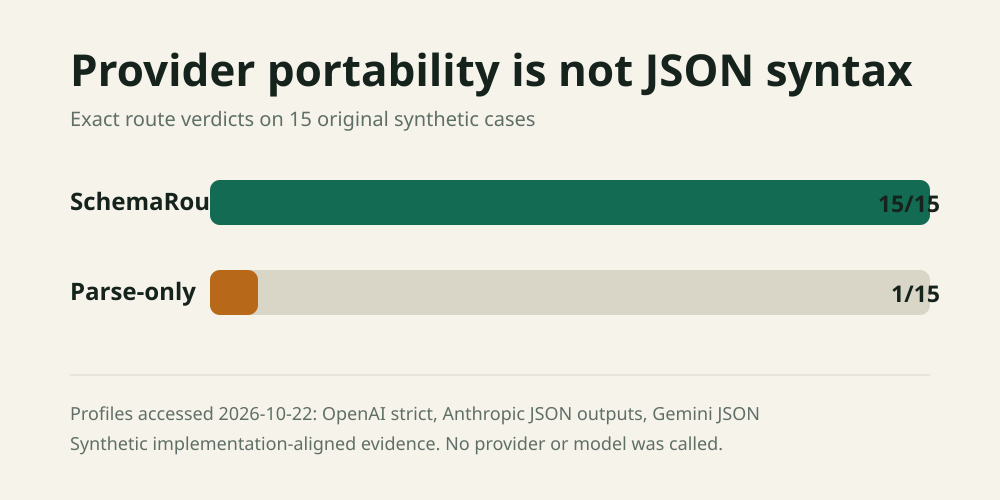

# SchemaRoute

SchemaRoute is an offline preflight for JSON Schema contracts that must survive an LLM provider route. It checks one schema against dated OpenAI, Anthropic, and Gemini structured-output profiles, then emits a content-minimized receipt with exact JSON Pointer findings.



## Why this exists

Provider-native structured output does not mean one portable JSON Schema dialect. Current documentation differs on root shapes, required fields, closed objects, recursion, grammar budgets, supported constraints, and constraints that are silently stripped. A primary request can work while a fallback request is rejected or enforces less than the application expects.

SchemaRoute gives CI and reviewers a reproducible answer before a model call:

- `portable`: no documented static conflict was found for the selected dated profiles.
- `requires_runtime_validation`: the route accepts or normalizes a construct that still needs application-side enforcement.
- `blocked`: at least one selected target has a documented deterministic conflict.

This is preflight evidence, not live-provider certification. It does not prove schema acceptance, semantic correctness, model quality, or future compatibility.

## Quick start

SchemaRoute requires Python 3.10 or newer and has no runtime dependencies.

```bash
python -m pip install -e .
schemaroute profiles
schemaroute audit examples/portable.schema.json
schemaroute audit examples/risky.schema.json --json receipt.json --html receipt.html
schemaroute benchmark benchmarks/provider-portability-v1.json --json evidence.json --svg evidence.svg
```

`audit` exits 0 only for `portable`, 1 for `requires_runtime_validation` or `blocked`, and 2 for invalid input. The JSON receipt includes a SHA-256 digest instead of the schema body. Findings still include JSON Pointers, which can reveal property names.

## What it checks

| Profile | Deterministic checks in 0.1 | Important boundary |
|---|---|---|
| `openai-strict-2026-10-22` | Object root, no root `anyOf`, every field required, closed objects, unsupported composition keywords, 5,000-property, 10-level, string, and enum limits | A clean result does not execute OpenAI's grammar compiler. |
| `anthropic-json-2026-10-22` | Closed objects, unsupported numeric and string constraints, recursion and external references, `allOf` with `$ref`, optional and union budgets, citations and prefill conflicts | Anthropic also has internal grammar limits that are not reducible to one public static formula. |
| `gemini-json-2026-10-22` | Documented root shape, warnings for stripped length and property-count constraints, warnings for keywords outside the dated portable subset | Gemini says large or deeply nested schemas may still be rejected and semantic validation remains local. |

Profiles are intentionally dated. Provider behavior changes, so a passing old profile must not be presented as current proof.

## Architecture

```text
schema.json + route features
          |
          v
  structural walker -----> stable metrics + SHA-256
          |
          v
  dated provider profiles
          |
          v
 findings sorted by profile, JSON Pointer, and code
          |
          +----> JSON receipt
          +----> standalone HTML
          +----> CI exit contract
```

The tool never rewrites a schema. Automatic rewriting can change application semantics and can hide a provider limitation. SchemaRoute reports the conflict so the application owner can choose whether to simplify the contract, split the route, or add explicit local validation.

## Evaluation

The original MIT-licensed `provider-portability-v1` corpus contains 15 synthetic cases for provider-specific root, object, composition, size, recursion, grammar-budget, feature-conflict, and ignored-constraint behavior.

| Method | Exact route verdicts | What it sees |
|---|---:|---|
| SchemaRoute 0.1 | 15/15 | Dated provider contracts and route features |
| Declared parse-only baseline | 1/15 | Valid JSON with an object schema container |

The corpus is implementation-aligned regression evidence. It is not a production false-positive study, a live-provider benchmark, or a broad JSON Schema conformance suite. Reproduce it with:

```bash
schemaroute benchmark benchmarks/provider-portability-v1.json \
  --json docs/experiments/provider-portability-v1-results.json \
  --svg docs/assets/provider-portability-v1.svg
python -m unittest discover -s tests -v
```

## Reference landscape and original contribution

- OpenAI, Anthropic, and Gemini publish different structured-output subsets and operational constraints.
- Pydantic AI transforms schemas behind typed multi-provider interfaces, but its active issue history shows that provider capability claims can still be ambiguous.
- llguidance and JSONSchemaBench measure constrained-decoding coverage and efficiency. They do not answer whether one fallback route has a portable commercial-provider contract.
- Applied ML led to the original Deequ data-quality work. SchemaRoute adapts its declarative preflight pattern to LLM schema routes, without reproducing or claiming the paper's company-scale results.

SchemaRoute's original contribution is the combination of dated provider profiles, route-wide verdicts, explicit runtime-validation warnings, stable JSON Pointer evidence, and fully offline CI artifacts. No upstream code, fixtures, or benchmark data were copied.

## Safety and interpretation

- Validate every structured response against the application's original schema, even after a portable result.
- Treat `requires_runtime_validation` as a deployment requirement, not an informational success.
- Keep profile dates visible in audit evidence and review them when SDKs, APIs, or models change.
- Do not put secrets, personal data, or protected health information in schema property names, enum values, or report paths.
- A schema-valid object can still be wrong, unsafe, unauthorized, or semantically inconsistent.

## Limitations

- The profiles cover selected documented rules, not all JSON Schema semantics or every provider endpoint, model, SDK, compatibility layer, or cloud host.
- SchemaRoute does not run provider dry-run endpoints or predict undocumented grammar-compiler limits.
- It does not resolve every indirect recursive reference graph or validate response instances.
- The Gemini portable subset is conservative. Unlisted keywords become warnings rather than unsupported-provider claims.
- JSON Pointers improve actionability but may reveal schema field names.
- The evaluation is small, synthetic, and authored alongside the implementation.

## Best next improvement

Add independently authored fixtures captured from provider and framework users, then implement an opt-in live dry-run adapter that records exact endpoint, SDK, model, date, latency, and cost while keeping the default test path offline.

## Project records

- [Approved implementation spec](docs/superpowers/specs/2026-10-22-schemaroute.md)
- [Reference review](docs/notes/2026-10-22-reference-review.md)
- [Profile decision](docs/decisions/2026-10-22-dated-conservative-profiles.md)
- [Dataset card](docs/datasets/provider-portability-v1.md)
- [Evaluation record](docs/experiments/2026-10-22-provider-portability-v1.md)
- [Model and provider card](docs/models/2026-10-22-no-model-profile.md)
- [Verification record](docs/notes/2026-10-22-verification.md)
- [Asset provenance](docs/assets/PROVENANCE.md)

## License

Released under the [MIT License](LICENSE). Provider names and documentation remain the property of their owners. This project is independent and is not affiliated with OpenAI, Anthropic, Google, Pydantic, Microsoft, EPFL, or AWS.
